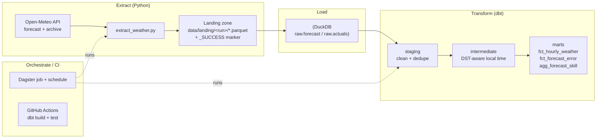

# Weather API Data Engineering Pipeline

An end-to-end **ELT** pipeline that ingests hourly weather **actuals and forecasts**
from the free [Open-Meteo](https://open-meteo.com) API, lands them in a raw layer,
and transforms them with **dbt** into analytics-ready marts — including a
**forecast-vs-actual skill** analysis.

Built to demonstrate core data-engineering skills: API extraction, a file-based
landing zone with a completion marker, warehouse loading, layered dbt modelling
(staging → intermediate → marts), data-quality testing, DST-aware timezone
handling, orchestration, and CI.

---

## Architecture



**Pattern:** Extract → land to files (+ `_SUCCESS`) → load to `raw` → transform in-warehouse with dbt.

---

## Tech stack

| Layer | Tool |
|---|---|
| Extraction | Python (`requests`, `pandas`) |
| Landing zone | Parquet files + `_SUCCESS` marker |
| Warehouse | DuckDB (zero-setup, file-based) |
| Transformation | dbt (`dbt-duckdb`) |
| Orchestration | Dagster (job + daily schedule) |
| CI | GitHub Actions (`dbt build`) |

---

## Project layout

```
05 weather-api-data-engineering/
├── extract/
│   └── extract_weather.py          # API -> landing zone -> DuckDB raw (+ _SUCCESS)
├── dbt/weather/
│   ├── dbt_project.yml
│   ├── profiles.yml                # DuckDB target (ICU for timezones)
│   ├── seeds/locations.csv         # location dimension (lat/lon + IANA timezone)
│   ├── macros/surrogate_key.sql
│   ├── tests/generic/test_accepted_range.sql
│   └── models/
│       ├── staging/                # typed, deduped 1:1 with sources
│       ├── intermediate/           # DST-aware local-time conversion
│       └── marts/                  # fct_hourly_weather, fct_forecast_error, agg_forecast_skill
├── orchestration/
│   └── dagster_pipeline.py         # extract -> dbt build job + schedule
├── .github/workflows/dbt-ci.yml    # builds & tests the transforms on every PR
├── requirements.txt
└── README.md
```

---

## Quickstart

```powershell
# 1. Create a virtual environment and install deps
python -m venv .venv
.\.venv\Scripts\Activate.ps1
pip install -r requirements.txt

# 2. Extract: pull weather data into the DuckDB raw schema
python extract\extract_weather.py --mode all

# 3. Transform: build + test all dbt models
cd dbt\weather
dbt build --profiles-dir .

# 4. (optional) Browse the lineage graph and docs
dbt docs generate --profiles-dir .
dbt docs serve --profiles-dir .
```

Run the whole thing on a schedule with Dagster:

```powershell
dagster dev -f orchestration\dagster_pipeline.py
```

### Inspect the results

```powershell
python -c "import duckdb; con=duckdb.connect('data/weather.duckdb'); print(con.sql('select * from main_marts.agg_forecast_skill_by_location order by temperature_mae_c'))"
```

---

## The data model

**staging** (`view`) — one model per source, typed + renamed, deduplicated to the
latest batch per (location, hour) so re-runs are idempotent.

**intermediate** (`view`) — converts UTC hours to **DST-aware local time** using
each location's IANA timezone (DuckDB ICU). London flips across BST, Kolkata keeps
its +05:30 offset, etc.

**marts** (`table`):
- `fct_hourly_weather` — actual + forecast measures side by side, per location/hour.
- `fct_forecast_error` — signed/absolute error on the overlap window (forecast vs actual).
- `agg_forecast_skill_by_location` — MAE, bias, RMSE per location (the headline table).

**Tests:** `not_null`, `unique`, `relationships`, source freshness, and a custom
`accepted_range` generic test (e.g. temperatures within physical bounds).

---

## What this demonstrates (and how it maps to a real production system)

This project is a modernised re-implementation of a common production pattern
(vendor API scrapers → CSV on a file share → loader → SQL Server → SQL views):

| Production pattern | Here |
|---|---|
| Per-vendor Python scraper | `extract_weather.py` |
| CSV dropped on an FTP/SMB share (staging) | Parquet in a landing zone |
| "Scrape complete" sentinel file | `_SUCCESS` marker gating the load |
| Proprietary bulk loader | DuckDB `raw` load step |
| Hand-written `CREATE VIEW` SQL | dbt staging/intermediate/marts (versioned + tested) |
| Proprietary scheduler | Dagster job + schedule |
| Per-4-digit-offset timezone logic in Python | Declarative IANA/DST handling in dbt |
| CI that publishes a pre-built binary | CI that **builds and tests** from source |

**Key upgrade:** ETL → **ELT**, with transformations managed as a tested,
version-controlled DAG instead of ad-hoc scripts and views.

---

## Notes

- Open-Meteo needs **no API key**. The archive ("actuals") endpoint lags ~2 days,
  so the forecast-error mart scores the overlap between recent forecast hours and
  available actuals.
- DuckDB keeps everything in a single local file (`data/weather.duckdb`); swap the
  dbt profile for Postgres/Snowflake/BigQuery to run the same models on a cloud
  warehouse.
